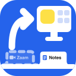

# RedirectTabCloser

A tiny Chromium extension that closes the tab once it has handed you off to a desktop app.

Works in all Chromium browsers.

## How it works

1. A page tries to open an app link, like `zoommtg://`.
2. You click "Open" and the app comes to the front.
3. The leftover tab closes.

Tabs you were actually using are left alone.

## Install (not in the Chrome Web Store yet)

1. `git clone https://github.com/ovolovikk/RedirectTabCloser.git`
2. Open `yourbrowser://extensions` (`chrome://`, `edge://`, `brave://`, ...)
3. Turn on **Developer mode**
4. Click **Load unpacked** and pick the cloned folder

## Permissions

- `tabs` - see when tabs open, and close them
- `webNavigation` - know which site a tab started on
- `webRequest` + all sites - notice a redirect into an app (read-only)
- `storage` - the on/off switch and the counter

## License

MIT
